# Poly Haven: Stone textures

**36 assets from [Poly Haven](https://polyhaven.com), dedicated to the public domain under [CC0](https://polyhaven.com/license).** Use them in any game, free or paid, and change them however you like; no credit is needed.

PBR textures as 1K and 2K JPG maps (colour, normal (GL and DX), roughness, AO, displacement and more). 875.0 MB in all.

This is a copy kept by [zuujis-cc0](https://github.com/zuujis-cc0) so game makers can take single files from GitHub. It is not made by or affiliated with Poly Haven: the originals, often in more formats and higher resolutions, are on [polyhaven.com](https://polyhaven.com). If they help you, consider [supporting Poly Haven](https://www.patreon.com/polyhaven/overview).

Every file is listed in [MANIFEST.tsv](MANIFEST.tsv) with its size and SHA-256. More free assets: [the Zuujis collection](https://github.com/zuujis-cc0/free-game-assets#readme).

| | | | |
| :-: | :-: | :-: | :-: |
| <a href="pavement_05">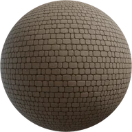</a> <b><a href="pavement_05">Pavement 05</a></b> by Jan Burghardt · <a href="https://polyhaven.com/a/pavement_05">source</a> | <a href="quarry_wall">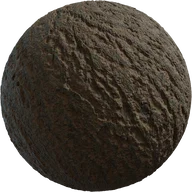</a> <b><a href="quarry_wall">Quarry Wall</a></b> by Dimitrios Savva · <a href="https://polyhaven.com/a/quarry_wall">source</a> | <a href="quarry_wall_02">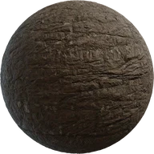</a> <b><a href="quarry_wall_02">Quarry Wall 02</a></b> by Dimitrios Savva · <a href="https://polyhaven.com/a/quarry_wall_02">source</a> | <a href="rabdentse_ruins_wall">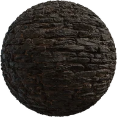</a> <b><a href="rabdentse_ruins_wall">Rabdentse Ruins Wall</a></b> by Amal Kumar · <a href="https://polyhaven.com/a/rabdentse_ruins_wall">source</a> |
| <a href="rectangular_paving">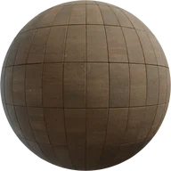</a> <b><a href="rectangular_paving">Rectangular Paving</a></b> by Dimitrios Savva · <a href="https://polyhaven.com/a/rectangular_paving">source</a> | <a href="red_slate_roof_tiles_01">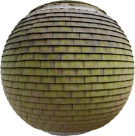</a> <b><a href="red_slate_roof_tiles_01">Red Slate Roof Tiles 01</a></b> by Rob Tuytel · <a href="https://polyhaven.com/a/red_slate_roof_tiles_01">source</a> | <a href="rock_01">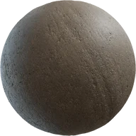</a> <b><a href="rock_01">Rock 01</a></b> by Rob Tuytel · <a href="https://polyhaven.com/a/rock_01">source</a> | <a href="rock_04">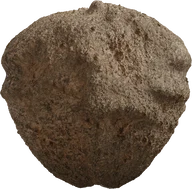</a> <b><a href="rock_04">Rock 04</a></b> by Rob Tuytel · <a href="https://polyhaven.com/a/rock_04">source</a> |
| <a href="rock_05">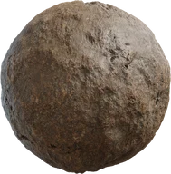</a> <b><a href="rock_05">Rock 05</a></b> by Rob Tuytel · <a href="https://polyhaven.com/a/rock_05">source</a> | <a href="rock_06">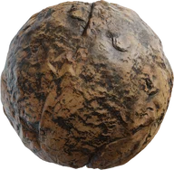</a> <b><a href="rock_06">Rock 06</a></b> by Rob Tuytel · <a href="https://polyhaven.com/a/rock_06">source</a> | <a href="rock_08">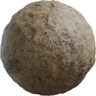</a> <b><a href="rock_08">Rock 08</a></b> by Rob Tuytel · <a href="https://polyhaven.com/a/rock_08">source</a> | <a href="rock_2">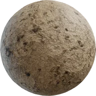</a> <b><a href="rock_2">Rock 2</a></b> by Rob Tuytel · <a href="https://polyhaven.com/a/rock_2">source</a> |
| <a href="rock_3">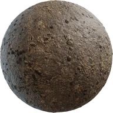</a> <b><a href="rock_3">Rock 3</a></b> by Rob Tuytel · <a href="https://polyhaven.com/a/rock_3">source</a> | <a href="rock_boulder_cracked">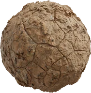</a> <b><a href="rock_boulder_cracked">Rock Boulder Cracked</a></b> by Dario Barresi, Dimitrios Savva · <a href="https://polyhaven.com/a/rock_boulder_cracked">source</a> | <a href="rock_boulder_dry">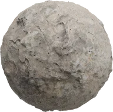</a> <b><a href="rock_boulder_dry">Rock Boulder Dry</a></b> by Dimitrios Savva, Rico Cilliers · <a href="https://polyhaven.com/a/rock_boulder_dry">source</a> | <a href="rock_face">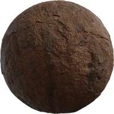</a> <b><a href="rock_face">Rock Face</a></b> by Dario Barresi, Greg Zaal · <a href="https://polyhaven.com/a/rock_face">source</a> |
| <a href="rock_face_03">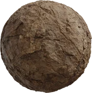</a> <b><a href="rock_face_03">Rock Face 03</a></b> by Dario Barresi, Rico Cilliers · <a href="https://polyhaven.com/a/rock_face_03">source</a> | <a href="rock_face_04">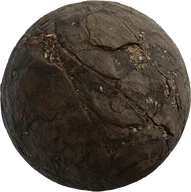</a> <b><a href="rock_face_04">Rock Face 04</a></b> by Dimitrios Savva · <a href="https://polyhaven.com/a/rock_face_04">source</a> |  <b><a href="rock_pitted_mossy">Rock Pitted Mossy</a></b> by Dimitrios Savva, Rico Cilliers · <a href="https://polyhaven.com/a/rock_pitted_mossy">source</a> | <a href="rock_surface">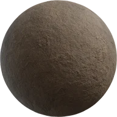</a> <b><a href="rock_surface">Rock Surface</a></b> by Amal Kumar · <a href="https://polyhaven.com/a/rock_surface">source</a> |
| <a href="rock_tile_floor">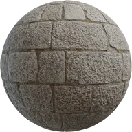</a> <b><a href="rock_tile_floor">Rock Tile Floor</a></b> by Charlotte Baglioni · <a href="https://polyhaven.com/a/rock_tile_floor">source</a> | <a href="rock_tile_floor_02">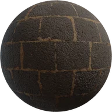</a> <b><a href="rock_tile_floor_02">Rock Tile Floor 02</a></b> by Charlotte Baglioni · <a href="https://polyhaven.com/a/rock_tile_floor_02">source</a> | <a href="rock_wall">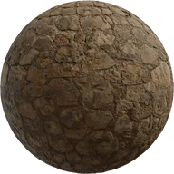</a> <b><a href="rock_wall">Rock Wall</a></b> by Charlotte Baglioni, Dario Barresi · <a href="https://polyhaven.com/a/rock_wall">source</a> | <a href="rock_wall_02">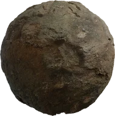</a> <b><a href="rock_wall_02">Rock Wall 02</a></b> by Rob Tuytel · <a href="https://polyhaven.com/a/rock_wall_02">source</a> |
| <a href="rock_wall_03">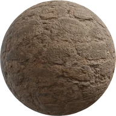</a> <b><a href="rock_wall_03">Rock Wall 03</a></b> by Charlotte Baglioni, Dario Barresi · <a href="https://polyhaven.com/a/rock_wall_03">source</a> | <a href="rock_wall_04">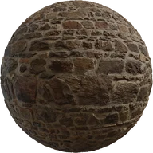</a> <b><a href="rock_wall_04">Rock Wall 04</a></b> by Charlotte Baglioni, Dario Barresi · <a href="https://polyhaven.com/a/rock_wall_04">source</a> | <a href="rock_wall_05">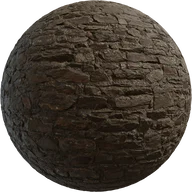</a> <b><a href="rock_wall_05">Rock Wall 05</a></b> by Charlotte Baglioni, Dario Barresi · <a href="https://polyhaven.com/a/rock_wall_05">source</a> | <a href="rock_wall_06">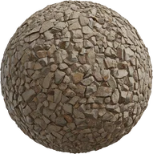</a> <b><a href="rock_wall_06">Rock Wall 06</a></b> by Dario Barresi, Dimitrios Savva · <a href="https://polyhaven.com/a/rock_wall_06">source</a> |
| <a href="rock_wall_07">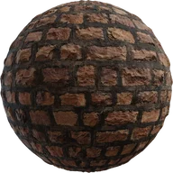</a> <b><a href="rock_wall_07">Rock Wall 07</a></b> by Amal Kumar · <a href="https://polyhaven.com/a/rock_wall_07">source</a> | <a href="rock_wall_08">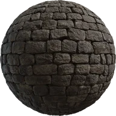</a> <b><a href="rock_wall_08">Rock Wall 08</a></b> by Amal Kumar · <a href="https://polyhaven.com/a/rock_wall_08">source</a> | <a href="rock_wall_09">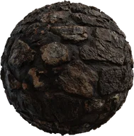</a> <b><a href="rock_wall_09">Rock Wall 09</a></b> by Dimitrios Savva · <a href="https://polyhaven.com/a/rock_wall_09">source</a> | <a href="rock_wall_10">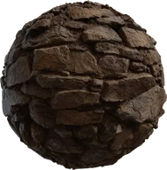</a> <b><a href="rock_wall_10">Rock Wall 10</a></b> by Amal Kumar · <a href="https://polyhaven.com/a/rock_wall_10">source</a> |
| <a href="rock_wall_11">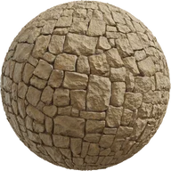</a> <b><a href="rock_wall_11">Rock Wall 11</a></b> by Dimitrios Savva · <a href="https://polyhaven.com/a/rock_wall_11">source</a> | <a href="rock_wall_12">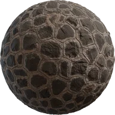</a> <b><a href="rock_wall_12">Rock Wall 12</a></b> by Amal Kumar · <a href="https://polyhaven.com/a/rock_wall_12">source</a> | <a href="rock_wall_13">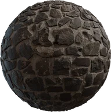</a> <b><a href="rock_wall_13">Rock Wall 13</a></b> by Amal Kumar · <a href="https://polyhaven.com/a/rock_wall_13">source</a> | <a href="rock_wall_14">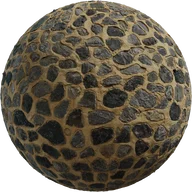</a> <b><a href="rock_wall_14">Rock Wall 14</a></b> by Dimitrios Savva · <a href="https://polyhaven.com/a/rock_wall_14">source</a> |

---

Kept up to date by this repository's own [update workflow](.github/workflows/update.yml), with code and plan from [cc0-mirror](https://github.com/zuujis-cc0/cc0-mirror). Something wrong? [Open an issue there](https://github.com/zuujis-cc0/cc0-mirror/issues/new) or use the [private report form](https://games.zuujis.com/report).
